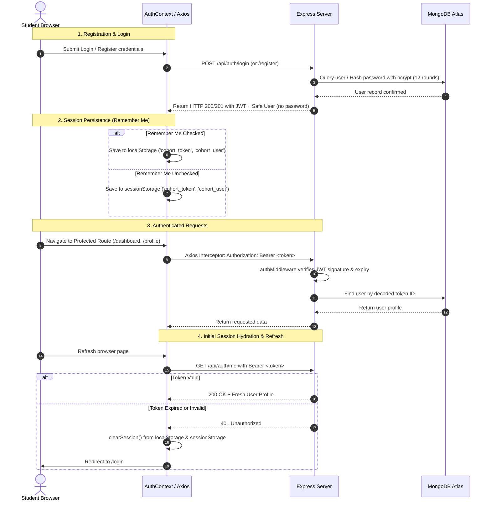

# 🎓 Cohort — Academic Peer Collaboration Platform

[](https://react.dev/)
[](https://vitejs.dev/)
[](https://reactrouter.com/)
[](https://tailwindcss.com/)
[](https://axios-http.com/)
[](LICENSE)

> A modern, academic-first collaboration network that empowers college students to discover compatible peers, organize study groups, share verified course materials, manage project teams, and stay ahead of coursework deadlines.

> [!NOTE]
> **Current Version**: Frontend prototype built with React + Vite, featuring simulated authentication, responsive multi-device workspaces, persistent accessible dark mode, and comprehensive local mock data. Production backend integration (Node.js, Express, MongoDB Atlas, Socket.IO) is detailed in the [Future Backend Roadmap](#-future-backend-integration-roadmap-mern).

---

## 📌 Problem Statement

In higher education, student collaboration is often fragmented across disjointed channels:
- **Siloed Learning & Peer Isolation**: Finding peers taking the same electives or with complementary technical skills (e.g., pairing a frontend developer with an ML enthusiast for a hackathon) relies on chance encounters.
- **Scattered Academic Resources**: Lecture slides, lab manuals, and exam notes are buried in messy WhatsApp chats, expired Discord links, and disorganized Google Drive folders.
- **Deadline Blindspots**: Managing multiple team projects, hackathons, and assignment submission deadlines across different courses leads to missed milestones and last-minute scrambles.
- **Lack of Focused Academic Spaces**: Generic social networks and messaging apps lack academic structure, syllabus tracking, and peer compatibility scoring.

**Cohort** solves this by unifying academic networking, peer matchmaking, resource sharing, and coursework tracking into a single cohesive platform.

---

## ✨ Key Features

### 1. 📊 Intelligent Student Dashboard (`/dashboard`)
- **Welcome Hero Section**: Personalized greeting, college department & semester badges, network readiness indicator, and a profile completion progress bar (with direct CTA to `/profile`).
- **Academic Metrics**: Real-time stats with positive trends tracking peer connections, study group memberships, shared resources, and active projects.
- **Quick Actions Bar**: Fast-track shortcuts for uploading resources, finding study partners, creating projects, and initiating academic discussions.
- **AI Study Assistant Preview**: Contextual copilot preview with suggested prompt chips for finding partners, locating DBMS resources, and planning DSA revisions.
- **Upcoming Coursework Deadlines**: Prioritized milestone cards highlighting urgency badges (e.g., 3 days left for DBMS Assignment, CodeIO Hackathon).
- **Top Peer Matches**: Algorithmic match percentage (e.g., 95% match with Ananya Rao), skill pills, and optimistic 1-click connection requests.
- **Learning Syllabus Progress**: Semantic progress bars tracking completion percentages across core engineering subjects (Data Structures, DBMS, OS, ML).
- **Recent Activity Timeline**: Chronological vertical feed of group joins, accepted connection requests, uploaded notes, and milestone completions.
- **Recommended Study Groups**: Subject-focused circles (Gradient Descent, OS Internals Circle, Placement Prep 2027) with 1-click join actions.

### 2. 🤝 Peer Matchmaking (`/peers` & `/peer-match`)
- Algorithmic compatibility scoring based on overlapping coursework, technical skills, semester year, and study habits.
- Filterable student directory with direct connection requests and messaging channels.

### 3. 👥 Study Groups & Peer Circles (`/study-groups`)
- Subject-specific learning circles with scheduled meeting times, active member counts, and integrated group discussion channels.

### 4. 📚 Academic Resource Hub (`/resources`)
- Curated repository for lecture slides, handwritten notes, lab manuals, and previous year exam papers categorized by branch and course.

### 5. 🚀 Project Collaboration Hub (`/projects`)
- Team assembly board for capstone projects, lab teams, and hackathons with role tags, milestone tracking, and task delegation.

### 6. 💬 Academic Discussions & Q&A (`/discussions`)
- Question-and-answer forum with code snippet highlighting and peer answers.

### 7. 💬 Collaboration & Messaging Workspace (`/messages`)
- Real-time communication workspace supporting Direct Messages, Study Circles, and Project Team Channels.
- Context-aware side panel for workspace file attachments, team member directories, and activity audits.
- Adaptive responsive layout with collapsible drawers for laptops and tablets, and dedicated view navigation on mobile devices.

### 8. 🌓 Persistent, Accessible Dark Mode
- Centralized theme provider supporting instant pre-paint hydration to prevent white/light-mode flashes.
- Full contrast compliance, visible focus outlines, and keyboard accessibility (`aria-label`, `aria-pressed`).
- Auto-syncs with OS `prefers-color-scheme` with persistent `localStorage` (`cohort_theme`) overrides.

---

## 🛠️ Tech Stack

### Frontend Architecture
- **Core**: [React 19](https://react.dev/) + [Vite 8](https://vitejs.dev/) (lightning-fast HMR and optimized production bundles)
- **Routing**: [React Router v7](https://reactrouter.com/) (declarative nested layouts with persistent navigation shell)
- **Styling**: [Tailwind CSS v4](https://tailwindcss.com/) + Custom CSS Design System
  - Warm academic palette: Forest Green (`#2F5D50`), Muted Sage (`#E4ECE7`), Warm Amber (`#E1993A`), and Off-White paper cards (`#FBFAF6`).
  - Full Light / Dark mode support.
- **Icons**: [Lucide React](https://lucide.dev/) (crisp, accessible SVGs)
- **HTTP Client**: [Axios](https://axios-http.com/) (preconfigured client with base URL and JWT interceptors)
- **Animations**: [Framer Motion](https://www.framer.com/motion/)

### Planned Backend Architecture (MERN)
- **Runtime & Framework**: [Node.js](https://nodejs.org/) & [Express.js](https://expressjs.com/)
- **Database**: [MongoDB Atlas](https://www.mongodb.com/atlas) with [Mongoose ODM](https://mongoosejs.com/)
- **Authentication**: Stateless JWT authentication with bcrypt password hashing
- **Real-Time Layer**: [Socket.io](https://socket.io/) for live study group messaging and presence
- **AI Microservice**: Integration with Gemini API for semantic resource search and AI study planning

---

## 📁 Project Structure

```text
Cohort/
├── public/                     # Static assets and favicon
├── src/
│   ├── assets/                 # Brand graphics and icons
│   ├── components/             # Reusable shared & layout components
│   │   ├── layout/             # Persistent AppShell, Sidebar, Navbar
│   │   ├── ui/                 # Reusable UI primitives (Button, Card, Avatar, etc.)
│   │   ├── peer-match/         # Peer matching components & match modals
│   │   ├── profile/            # Profile widgets & bio editors
│   │   └── study-groups/       # Study group cards & live session widgets
│   ├── constants/              # Application routes, navigation schema, color tokens
│   ├── context/                # Global React contexts
│   │   ├── AuthContext.jsx     # Safe development authentication & session state
│   │   ├── ThemeContext.jsx    # Persistent accessible light/dark theme provider
│   │   └── authStorage.js      # Session helpers (Remember me localStorage/sessionStorage)
│   ├── data/                   # Feature mock databases (resources, notifications)
│   ├── features/               # Feature-sliced modular architecture
│   │   ├── auth/               # Authentication forms, password strength, guards
│   │   ├── dashboard/          # Dashboard stats, hero, deadlines, syllabus meters
│   │   ├── discussions/        # Academic forum, Q&A threads, tag filters
│   │   ├── messages/           # Real-time workspace chat, composer, file & member drawers
│   │   ├── peer-match/         # Peer matchmaking algorithms & filter controls
│   │   ├── profile/            # Student academic portfolio, bio, skills editor
│   │   ├── projects/           # Collaborative project hub, task board, recruitment
│   │   ├── resources/          # Course notes repository, file uploads, previews
│   │   └── study-groups/       # Subject circles, live sessions, schedule cards
│   ├── lib/                    # Shared utilities (Tailwind merge, clsx helpers)
│   ├── pages/                  # Top-level page routes
│   │   ├── DashboardPage.jsx   # Primary student dashboard
│   │   ├── CollaborationWorkspace.jsx # Messages & collaboration workspace
│   │   ├── PeerMatch.jsx       # Peer discovery & connection engine
│   │   ├── Profile.jsx         # User academic profile
│   │   ├── Projects.jsx        # Project collaboration hub
│   │   ├── Resources.jsx       # Resource repository
│   │   ├── StudyGroups.jsx     # Study group circles
│   │   ├── Discussions.jsx     # Academic Q&A discussions
│   │   ├── Login.jsx           # Student login
│   │   ├── Register.jsx        # Student registration
│   │   ├── ForgotPassword.jsx  # Password recovery
│   │   └── ResetPassword.jsx   # Password reset
│   ├── services/
│   │   └── api.js              # Axios HTTP client configured for future backend endpoints
│   ├── styles/                 # Feature stylesheet backups
│   ├── App.jsx                 # Route definitions, guards, and theme/auth providers
│   ├── index.css               # Global CSS tokens, dark mode variables, base typography
│   └── main.jsx                # React root entry point
├── package.json
└── vite.config.js
```

---

## 🚀 Getting Started

### Prerequisites
- **Node.js**: `v18.x` or higher (`v20+` recommended)
- **npm**: `v9.x` or higher
- **MongoDB**: A free [MongoDB Atlas](https://www.mongodb.com/cloud/atlas) cluster connection string or a local MongoDB Community server running on port `27017`.

---

### Installation & Setup

#### 1. Clone the repository
```bash
git clone https://github.com/Shreyas-satish-07/academic-p2p-network.git
cd academic-p2p-network
```

#### 2. Install Frontend Dependencies (Root)
```bash
npm install
```

#### 3. Install Backend Dependencies (Server)
```bash
cd server
npm install
cd ..
```

---

### Environment Variables

#### Frontend Configuration (`.env`)
Create a `.env` file in the project root:
```env
VITE_API_BASE_URL=http://localhost:5000/api
```
*(Reference template available in [`.env.example`](.env.example))*

#### Backend Configuration (`server/.env`)
Create a `.env` file inside the `server/` directory:
```env
NODE_ENV=development
PORT=5000
MONGODB_URI=mongodb+srv://<username>:<password>@<cluster>.mongodb.net/cohort?retryWrites=true&w=majority
JWT_SECRET=replace_this_with_a_secure_long_random_secret_string
JWT_EXPIRES_IN=7d
CLIENT_URL=http://localhost:5173
```
*(Reference template available in [`server/.env.example`](server/.env.example). **Never commit real credentials to git!**)*

---

### Running Frontend & Backend (Separate Terminals)

#### Terminal 1 — Backend Express Server
```bash
cd server
npm run dev
```
The server will start listening at [http://localhost:5000](http://localhost:5000) and connect to MongoDB.

#### Terminal 2 — Frontend React App
```bash
npm run dev
```
Open [http://localhost:5173](http://localhost:5173) in your browser.

---

### Testing & Verification Commands

```bash
# Frontend Linting
npm run lint

# Frontend Production Build
npm run build
```

---

## 🔐 Phase 1 Authentication API

### Endpoints Specification

| HTTP Method | Endpoint | Access | Request Body / Headers | Success Response Format | Description |
| :--- | :--- | :--- | :--- | :--- | :--- |
| `GET` | `/api/health` | Public | None | `{"success": true, "message": "Cohort API is running"}` | Server liveness & health check |
| `POST` | `/api/auth/register` | Public | `{ name, email, password, college, department, semester }` | HTTP 201: `{"success": true, "message": "...", "data": {"user": {...}, "token": "..."}}` | Registers new student, hashes password with bcrypt (12 salt rounds), issues JWT |
| `POST` | `/api/auth/login` | Public | `{ email, password }` | HTTP 200: `{"success": true, "message": "...", "data": {"user": {...}, "token": "..."}}` | Validates credentials, issues JWT and safe user object |
| `GET` | `/api/auth/me` | Private | `Authorization: Bearer <token>` | HTTP 200: `{"success": true, "message": "...", "data": {"user": {...}, "token": "..."}}` | Retrieves authenticated user profile from verified JWT |
| `POST` | `/api/auth/logout` | Public | Optional Bearer token | HTTP 200: `{"success": true, "message": "Logged out successfully"}` | Informs server of logout; frontend purges client session tokens |

---

### 🔄 End-to-End JWT Authentication Flow



---

### 🗄️ MongoDB Atlas Setup Guide

1. Sign in to your [MongoDB Atlas account](https://www.mongodb.com/cloud/atlas).
2. Create a free **M0 Shared Cluster**.
3. Under **Security → Database Access**, create a database user with Read/Write privileges.
4. Under **Security → Network Access**, add your current IP address (or `0.0.0.0/0` for development).
5. Under **Database → Connect → Drivers**, choose **Node.js** and copy the connection string.
6. Paste the connection string into `server/.env` as `MONGODB_URI` and replace `<password>` with your database user password.

---

### 🧪 Postman & Thunder Client Testing Examples

#### 1. Register Student
- **Method**: `POST`
- **URL**: `http://localhost:5000/api/auth/register`
- **Headers**: `Content-Type: application/json`
- **Body**:
```json
{
  "name": "Rahul Sharma",
  "email": "rahul.sharma@example.edu",
  "password": "StrongPassword123",
  "college": "Bangalore Institute of Technology",
  "department": "Computer Science",
  "semester": "6th Semester"
}
```

#### 2. Login
- **Method**: `POST`
- **URL**: `http://localhost:5000/api/auth/login`
- **Headers**: `Content-Type: application/json`
- **Body**:
```json
{
  "email": "rahul.sharma@example.edu",
  "password": "StrongPassword123"
}
```

#### 3. Current User Profile
- **Method**: `GET`
- **URL**: `http://localhost:5000/api/auth/me`
- **Headers**: `Authorization: Bearer <PASTE_JWT_TOKEN_HERE>`

#### 4. Logout
- **Method**: `POST`
- **URL**: `http://localhost:5000/api/auth/logout`

---

## 🌐 Deployment

- **Frontend Deployment**: Deployment: Coming soon (Live production link will be added upon deployment).
- **Target Platform**: [Vercel](https://vercel.com/) / [Netlify](https://www.netlify.com/) for frontend static delivery; Node.js container hosting for backend API.

---

## 📄 License

This project is licensed under the MIT License — see the [LICENSE](LICENSE) file for details.
