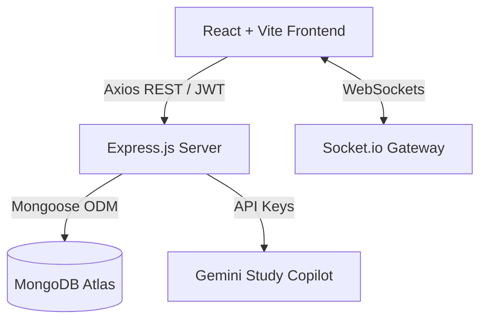

# 🎓 Cohort — Academic Peer Collaboration Platform

[](https://react.dev/)
[](https://vitejs.dev/)
[](https://reactrouter.com/)
[](https://tailwindcss.com/)
[](https://axios-http.com/)
[](LICENSE)

> A modern, academic-first collaboration network that empowers college students to discover compatible peers, organize study groups, share verified course materials, manage project teams, and stay ahead of coursework deadlines.

---

## 📌 Problem Statement

In higher education, student collaboration is often fragmented across disjointed channels:
- **Siloed Learning & Peer Isolation**: Finding peers taking the same electives or with complementary technical skills (e.g., pairing a frontend developer with an ML enthusiast for a hackathon) relies on chance encounters.
- **Scattered Academic Resources**: Lecture slides, lab manuals, and exam notes are buried in messy WhatsApp chats, expired Discord links, and disorganized Google Drive folders.
- **Deadline Blindspots**: Managing multiple team projects, hackathons, and assignment submission deadlines across different courses leads to missed milestones and last-minute scrambles.
- **Lack of Focused Academic Spaces**: Generic social networks and messaging apps lack academic structure, syllabus tracking, and peer compatibility scoring.

**Cohort** solves this by unifying academic networking, peer matchmaking, resource sharing, and coursework tracking into a single cohesive platform.

---

## ✨ Key Features

### 1. 📊 Intelligent Student Dashboard
- **Welcome Hero Section**: Personalized greeting, college department & semester badges, network readiness indicator, and a profile completion progress bar (with direct CTA to `/profile`).
- **Academic Metrics**: Real-time stats with positive trends tracking peer connections, study group memberships, shared resources, and active projects.
- **Quick Actions Bar**: Fast-track shortcuts for uploading resources, finding study partners, creating projects, and initiating academic discussions.
- **AI Study Assistant Preview**: Contextual copilot preview with suggested prompt chips for finding partners, locating DBMS resources, and planning DSA revisions.
- **Upcoming Coursework Deadlines**: Prioritized milestone cards highlighting urgency badges (e.g., 3 days left for DBMS Assignment, CodeIO Hackathon).
- **Top Peer Matches**: Algorithmic match percentage (e.g., 95% match with Ananya Rao), skill pills, and optimistic 1-click connection requests.
- **Learning Syllabus Progress**: Semantic progress bars tracking completion percentages across core engineering subjects (Data Structures, DBMS, OS, ML).
- **Recent Activity Timeline**: Chronological vertical feed of group joins, accepted connection requests, uploaded notes, and milestone completions.
- **Recommended Study Groups**: Subject-focused circles (Gradient Descent, OS Internals Circle, Placement Prep 2027) with 1-click join actions.

### 2. 🤝 Peer Matchmaking (`/peers` & `/peer-match`)
- Algorithmic compatibility scoring based on overlapping coursework, technical skills, semester year, and study habits.
- Filterable student directory with direct connection requests and messaging channels.

### 3. 👥 Study Groups & Peer Circles (`/study-groups`)
- Subject-specific learning circles with scheduled meeting times, active member counts, and integrated group discussion channels.

### 4. 📚 Academic Resource Hub (`/resources`)
- Curated repository for lecture slides, handwritten notes, lab manuals, and previous year exam papers categorized by branch and course.

### 5. 🚀 Project Collaboration Hub (`/projects`)
- Team assembly board for capstone projects, lab teams, and hackathons with role tags, milestone tracking, and task delegation.

### 6. 💬 Academic Discussions & Q&A (`/discussions`)
- Question-and-answer forum with code snippet highlighting and peer answers.

---

## 🛠️ Tech Stack

### Frontend Architecture
- **Core**: [React 19](https://react.dev/) + [Vite 8](https://vitejs.dev/) (lightning-fast HMR and optimized production bundles)
- **Routing**: [React Router v7](https://reactrouter.com/) (declarative nested layouts with persistent navigation shell)
- **Styling**: [Tailwind CSS v4](https://tailwindcss.com/) + Custom CSS Design System
  - Warm academic palette: Forest Green (`#2F5D50`), Muted Sage (`#E4ECE7`), Warm Amber (`#E1993A`), and Off-White paper cards (`#FBFAF6`).
  - Full Light / Dark mode support.
- **Icons**: [Lucide React](https://lucide.dev/) (crisp, accessible SVGs)
- **HTTP Client**: [Axios](https://axios-http.com/) (preconfigured client with base URL and JWT interceptors)
- **Animations**: [Framer Motion](https://www.framer.com/motion/)

### Planned Backend Architecture (MERN)
- **Runtime & Framework**: [Node.js](https://nodejs.org/) & [Express.js](https://expressjs.com/)
- **Database**: [MongoDB Atlas](https://www.mongodb.com/atlas) with [Mongoose ODM](https://mongoosejs.com/)
- **Authentication**: Stateless JWT authentication with bcrypt password hashing
- **Real-Time Layer**: [Socket.io](https://socket.io/) for live study group messaging and presence
- **AI Microservice**: Integration with Gemini API for semantic resource search and AI study planning

---

## 📁 Project Structure

```text
Cohort/
├── public/                     # Static assets and icons
├── src/
│   ├── assets/                 # Brand graphics and images
│   ├── components/
│   │   ├── layout/             # Persistent AppShell, Sidebar, Topbar/Navbar
│   │   ├── ui/                 # Reusable UI primitives (Button, Card, Avatar, Progress)
│   │   ├── peer-match/         # Peer matching components
│   │   ├── profile/            # Student profile components
│   │   └── study-groups/       # Study group widgets and session cards
│   ├── constants/
│   │   ├── colors.js           # Palette tokens
│   │   ├── navigation.js       # Sidebar navigation groups and badge items
│   │   └── routes.js           # Application route definitions
│   ├── data/                   # Mock databases for peers, groups, resources, projects
│   ├── features/
│   │   └── dashboard/          # Feature-sliced Dashboard module
│   │       ├── components/
│   │       │   ├── AIAssistantCard.jsx     # AI Copilot preview & prompt chips
│   │       │   ├── LearningProgress.jsx   # Semantic progress bars for syllabi
│   │       │   ├── PeerMatches.jsx        # Compatible peer cards with connect action
│   │       │   ├── QuickActions.jsx       # 4 high-priority workflow shortcuts
│   │       │   ├── RecentActivity.jsx     # Vertical timeline feed
│   │       │   ├── RecommendedGroups.jsx  # Study group cards with join action
│   │       │   ├── StatCard.jsx           # Individual metric card with trend badge
│   │       │   ├── UpcomingDeadlines.jsx  # Milestone rows with urgency indicators
│   │       │   └── WelcomeHero.jsx        # Greeting header & profile completion meter
│   │       ├── dashboard.css               # Warm academic dashboard styling
│   │       └── dashboardData.js           # API-ready mock state models
│   ├── lib/
│   │   └── utils.js            # Tailwind merge and class utility helpers
│   ├── pages/                  # Page route views
│   │   ├── DashboardPage.jsx   # Primary dashboard view (orchestrates feature cards)
│   │   ├── PeerMatch.jsx       # Peer discovery page
│   │   ├── Profile.jsx         # User academic profile & portfolio
│   │   ├── Projects.jsx        # Project collaboration hub
│   │   ├── Resources.jsx       # Resource repository
│   │   └── StudyGroups.jsx     # Study group circles
│   ├── services/
│   │   └── api.js              # Axios API client with interceptors
│   ├── App.jsx                 # Route configurations and layout wrapper
│   ├── index.css               # Global theme tokens, typography, and base resets
│   └── main.jsx                # React root entry point
├── package.json                # Dependencies and build scripts
└── vite.config.js              # Vite configuration
```

---

## 🚀 Getting Started

### Prerequisites
- **Node.js**: `v18.x` or higher
- **npm**: `v9.x` or higher

### Installation & Setup

1. **Clone the repository**:
   ```bash
   git clone https://github.com/Shreyas-satish-07/academic-p2p-network.git
   cd academic-p2p-network
   ```

2. **Install dependencies**:
   ```bash
   npm install
   ```

3. **Configure Environment Variables** (Optional for frontend development):
   Create a `.env` file in the root directory:
   ```env
   VITE_API_BASE_URL=http://localhost:5000/api
   ```

4. **Start the local development server**:
   ```bash
   npm run dev
   ```
   Open [http://localhost:5173](http://localhost:5173) in your browser.

5. **Run Linting**:
   ```bash
   npm run lint
   ```

6. **Build for Production**:
   ```bash
   npm run build
   ```
   The compiled assets will be output to the `dist/` folder.

---

## 📸 Screenshots & UI Preview

| Section | Preview Description |
| :--- | :--- |
| **Welcome Hero & Profile Completion** | Forest-green academic hero banner displaying student department, semester, online network pulse, and 75% profile completion meter. |
| **Academic Stats & Quick Actions** | 4 stat cards with positive trend indicators and 4 prominent workflow cards (Share Resource, Find Peers, Create Project, Ask Questions). |
| **Deadlines & AI Study Assistant** | Milestone rows with countdowns (`3 days left`, `6 days left`) alongside the Cohort AI Copilot prompt chips. |
| **Peer Matching & Syllabus Progress** | Top peer match cards with 95% compatibility scores and semantic progress bars for Data Structures, DBMS, OS, and ML. |
| **Activity Timeline & Study Circles** | Vertical chronological feed and 1-click join cards for subject-focused study groups. |

*(Screenshots will be uploaded here upon final UI preview capture)*

---

## 🗺️ Future Backend Integration Roadmap (MERN)

The frontend is built to connect seamlessly to an Express.js and MongoDB backend. All data models in [`dashboardData.js`](file:///c:/MyLearning/AI_Project/Cohort/src/features/dashboard/dashboardData.js) reflect planned MongoDB schemas:



### Planned API Endpoints
| HTTP Method | Route | Description |
| :--- | :--- | :--- |
| `GET` | `/api/dashboard` | Returns consolidated user profile, metrics, deadlines, and activity |
| `GET` | `/api/peers/top-matches` | Algorithmic peer suggestions based on course overlap |
| `POST` | `/api/peers/:id/connect` | Sends a peer connection request |
| `GET` | `/api/study-groups/recommended`| Retrieves recommended study groups for the student |
| `POST` | `/api/study-groups/:id/join` | Joins a study circle |
| `GET` | `/api/learning-progress` | Retrieves syllabus tracking percentages |
| `GET` | `/api/resources` | Queries course resource library with subject filters |
| `POST` | `/api/resources/upload` | Uploads course notes or reference documents |

---

## 🌐 Deployment

- **Frontend**: Ready for deployment on [Vercel](https://vercel.com/) / [Netlify](https://www.netlify.com/).
- **Live Demo Link**: `https://cohort-academic.vercel.app` *(Deployment link to be updated upon live release)*

---

## 📄 License

This project is licensed under the MIT License — see the [LICENSE](LICENSE) file for details.
